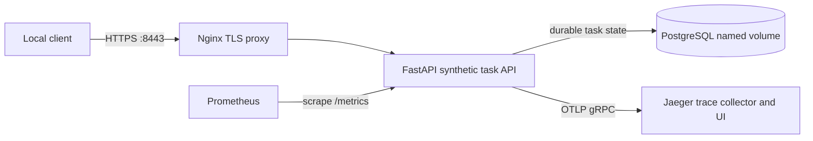

# Week 23 — Production Deployment Lab

A local-only Compose deployment for a deterministic synthetic Agent API. It
stores completed task records in PostgreSQL, terminates TLS at a reverse proxy,
scrapes bounded-cardinality Prometheus metrics, and exports correlated
OpenTelemetry traces to Jaeger.



All published ports bind to `127.0.0.1`. PostgreSQL and the API have no host
ports. The only operations are bounded `echo` and `sum`; no model, homelab,
external tool, or real user data is involved.

## Prerequisites

- Docker Engine with Docker Compose v2
- Python 3.12 or newer
- OpenSSL

From this directory, install the lab package and test dependencies:

```sh
python3 -m venv .venv
.venv/bin/python -m pip install -e '.[dev]'
```

## Generate local secrets and certificates

```sh
./scripts/init-local.sh
```

This creates an unpredictable PostgreSQL password and a short-lived
self-signed certificate for `localhost` under `secrets/`. Those files and the
generated `.env` containing only the local container UID/GID are ignored by
Git. The API and database receive the password through a read-only Compose
secret file; it is never placed in the image or Compose environment. The TLS
private key is also mounted as a Compose secret. The generator is repeatable:
it keeps existing credentials so they continue to match the named database
volume.

CI supplies a fresh runner-only `POSTGRES_PASSWORD` environment value to the
same generator. It creates no committed credential and requires no GitHub
secret or live service account.

## Deploy and check health

```sh
docker compose up --build --detach --wait
curl --cacert secrets/local-tls.crt https://localhost:8443/health/live
curl --cacert secrets/local-tls.crt https://localhost:8443/health/ready
```

`/health/live` reports whether the API process responds. `/health/ready` also
checks PostgreSQL. The database and API have Compose health checks, and the
proxy health check calls the TLS endpoint from inside the container.

## Create and retrieve a task

The input is validated and size-bounded. `sum` accepts 1–16 integers; `echo`
accepts one message of at most 256 characters. Unknown fields are rejected.

```sh
curl --cacert secrets/local-tls.crt \
  -H 'content-type: application/json' \
  -d '{"operation":"sum","input":{"numbers":[3,4,-2]}}' \
  https://localhost:8443/v1/tasks
```

The response includes a task ID, deterministic result, completed status,
creation time, and trace ID. Fetch it with
`GET https://localhost:8443/v1/tasks/<task-id>`.

## Run tests, deterministic evals, and recovery smoke checks

```sh
.venv/bin/python -m pytest -q
./scripts/verify-compose.sh
```

The eval dataset checks fixed `sum` and `echo` cases, request/response trace
correlation, task retrieval, structured API request logs and their trace IDs,
metrics, Jaeger trace receipt, and Prometheus scraping. The Compose smoke
script reads `docker compose logs` to verify the request records, restarts the
API, and runs `docker compose down` followed by `up`. It deliberately leaves
the named `postgres_data` volume in place and verifies all task records again.
It leaves the stack running for inspection. The CI workflow runs the same suite
and smoke/eval sequence.

## Inspect logs, metrics, and traces

```sh
docker compose logs --follow api proxy db prometheus jaeger
curl --cacert secrets/local-tls.crt https://localhost:8443/metrics
```

- Prometheus UI: <http://localhost:9090>. Query `up{job="agent-api"}` or
  `agent_task_requests_total`.
- Jaeger UI: <http://localhost:16686>. Search service `week23-agent-api`.
- Each API response has `X-Trace-Id`; the same ID appears in the API's
  structured request log, the persisted task row/response, and its Jaeger
  trace. Send a W3C `traceparent` header to continue an existing trace.

Request logs include the normalized route, status, duration, and trace ID. They
omit request bodies, query strings, and secret values. Metrics use fixed route
templates and operation names so task IDs do not create unbounded label sets.

## Teardown and recovery

Stop the containers while preserving durable task state:

```sh
docker compose down
```

Start again and retrieve a previously created task; the named volume remains.
To remove the database volume and all stored tasks:

```sh
docker compose down --volumes --remove-orphans
```

To discard local secrets and start with a new database password, first remove
the containers and volume, then remove the ignored local files and regenerate:

```sh
docker compose down --volumes --remove-orphans
rm -rf secrets .local .env
./scripts/init-local.sh
docker compose up --build --detach --wait
```

## Scope and production limitations

This is a deployment exercise, not a production service. It has no
authentication, authorization, model execution, background queue, or real
homelab integration. The deterministic requests complete synchronously, and
PostgreSQL is already the durable source of truth, so Redis would add a second
state system without improving this lab's behavior. Jaeger stores traces in
memory; Prometheus retains only one day of local metrics. The self-signed TLS
certificate and local password file are for this machine only. There are no
backups, managed secret service, schema migration framework, connection pool,
high availability, or production alerting. Do not expose these ports or use
real credentials/data; a real deployment needs separately reviewed identity,
network, secret, backup, migration, capacity, and recovery controls.
