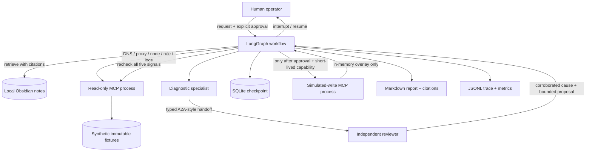

# Week 24: Autonomous HomeLab SRE Agent

A bounded, offline SRE diagnostic lab for the synthetic incident **“Netflix cannot be reached.”** It demonstrates cited Obsidian retrieval, custom MCP tool calling, LangGraph state/checkpointing, two specialist-agent handoffs, an explicit human approval interrupt, isolated simulated writes, recovery verification, and deterministic evaluation.

All DNS answers, proxy/node/rule states, and logs are local fixtures. The lab uses no LLM API, credentials, live homelab services, external MCP server, or network access. Its only write-capable tool changes an in-memory simulator overlay after runtime approval.

## Quick start

Requires Python 3.12+ and `uv`:

```sh
uv sync --locked
uv run pytest
uv run w24-sre eval
uv run w24-sre demo --case proxy-rule-mismatch
```

The interactive demo prints the diagnosis and proposed action, then pauses at a LangGraph checkpoint. It asks for an explicit `approve` or `reject` decision. EOF or any other response leaves the run paused; no write tool is started. The optional `--decision approve` flag is also an explicit runtime approval input. A paused run prints its thread ID so it can be resumed with `uv run w24-sre resume THREAD_ID --decision approve --approver alice`; use `--decision reject` to decline it.

Eval fixtures provide explicit synthetic approvals so the three demos can be replayed deterministically. They do not authorize any real action.
Separate `evals/approval-gate.jsonl` fixtures exercise a paused run and a rejected proposal; both must produce zero simulated-write calls.

## Architecture



See [the full specification](docs/spec.md) and [the Mermaid source](docs/architecture.mmd).

## Safety model

- The diagnostic MCP subprocess exposes exactly five read-only tools. Its inputs select only a fixed local scenario; it has no sockets, secrets, command execution, or write API.
- A separate simulated-write MCP subprocess exposes one allowlisted tool. It is not started until the approval interrupt resumes with an `approve` decision bound to the exact proposal digest. The process also requires a one-run capability passed only after approval; the capability is excluded from checkpoints, traces, and output.
- The write tool returns an in-memory overlay. It does not contact a service, edit a file, or change an actual rule, resolver, node, or proxy.
- Markdown notes, user text, and logs are untrusted data. Retrieval removes instruction-like paragraphs; correlation reads structured status fields and fixed event codes only.
- Docker runs with `network_mode: none`, a read-only root filesystem, and dropped Linux capabilities. `/data` holds checkpoints/run artifacts; a separate named volume holds only confirmed report exports under `vault/knowledge/reports/`.
- Saving a report under `vault/knowledge/reports/` is a separate optional operation and requires its own interactive confirmation. Saved reports remain searchable as prior-incident context, but ranked after curated top-level runbooks and limited to one secondary citation per retrieval. Diagnosis facts and required citations come from canonical runbooks.

This lab is a portfolio simulator, not a production SRE agent or a connector to a live MCP boundary.

## Scenario matrix

| Case | Synthetic cause | Proposed simulation | Expected verification |
|---|---|---|---|
| `proxy-rule-mismatch` | Netflix rule incorrectly selects direct egress | Restore the allowlisted media proxy route | Netflix route is proxied; checks recover |
| `unhealthy-egress-node` | Selected egress node is draining | Shift the synthetic route to the ready node | Node and route checks recover |
| `stale-dns-target` | Cached fixture answer points to an obsolete target | Flush the simulated Netflix cache entry | DNS and downstream checks recover |

## Commands

```sh
uv run w24-sre eval
uv run w24-sre demo --case proxy-rule-mismatch
uv run w24-sre demo --case unhealthy-egress-node --decision reject
uv run w24-sre resume THREAD_ID --decision approve --approver alice
uv run w24-sre metrics
```

Run `uv run w24-sre --help` for data-directory and report-export options. Report export asks for separate confirmation and accepts only a generated report plus a fixed `vault/knowledge/reports/` destination.

## Docker Compose

```sh
docker compose config --quiet
docker compose run --rm lab eval
```

The lab container has no network and uses a read-only root filesystem. SQLite checkpoints and deterministic run artifacts are written to its `/data` volume. There are no exposed ports.

## Evals and portfolio evidence

`uv run w24-sre eval` checks three complete cause-to-verification flows, plus separate pause and rejection cases. Approved flows must pass through an observed approval interrupt; the eval also checks prompt-injection handling. Pass/fail summaries and reports are deterministic. Traces and metrics include observed durations and can vary between runs. The checked-in `evidence/` directory contains the eval summary, traces/reports, and security-boundary details.

See [the evidence index](evidence/README.md), [security model](evidence/security-model.md), [Compose verification](evidence/compose-verification.md), and [interactive approval demo](evidence/operator-demo/transcript.txt) with its [trace](evidence/operator-demo/trace.jsonl) and [metrics](evidence/operator-demo/metrics.json).

## Source references

- MCP SDK v2 server/client and stdio patterns: [official MCP Python SDK](https://py.sdk.modelcontextprotocol.io/), [stdio transports](https://py.sdk.modelcontextprotocol.io/client/transports/), and [server execution](https://py.sdk.modelcontextprotocol.io/run/).
- LangGraph interrupt/resume and checkpointing: [interrupt reference](https://reference.langchain.com/python/langgraph/types/interrupt) and [checkpoint reference](https://reference.langchain.com/python/langgraph/checkpoints).
- Compose network isolation and read-only services: [Docker Compose networking](https://docs.docker.com/compose/how-tos/networking/) and [service reference](https://docs.docker.com/reference/compose-file/services/).
